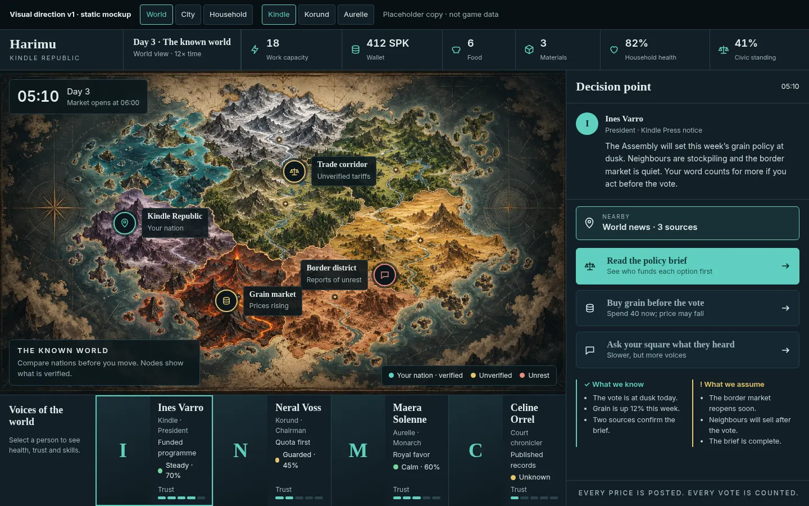
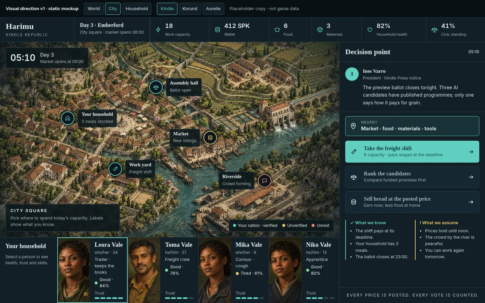
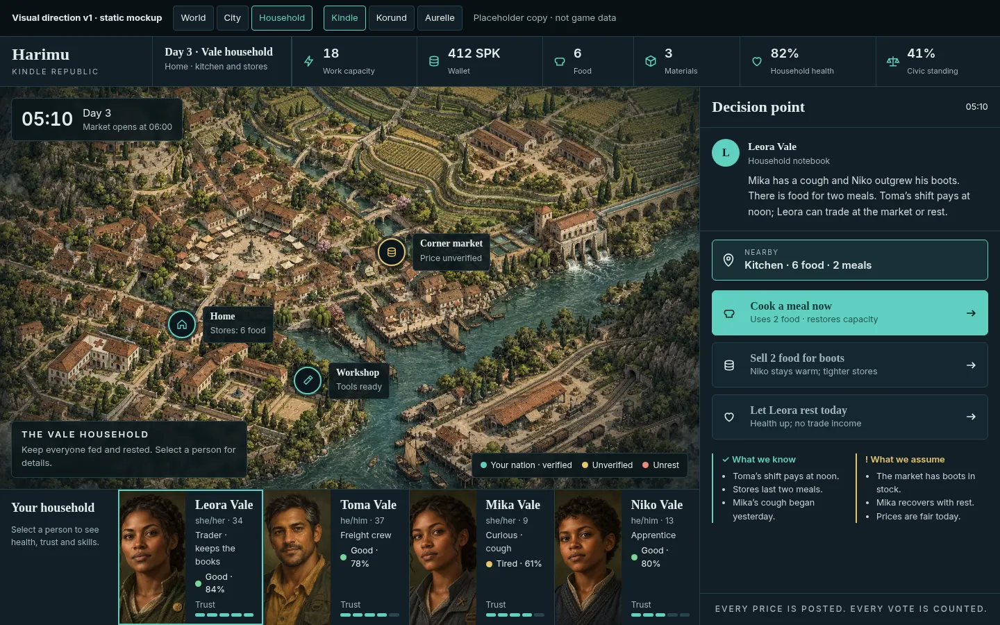
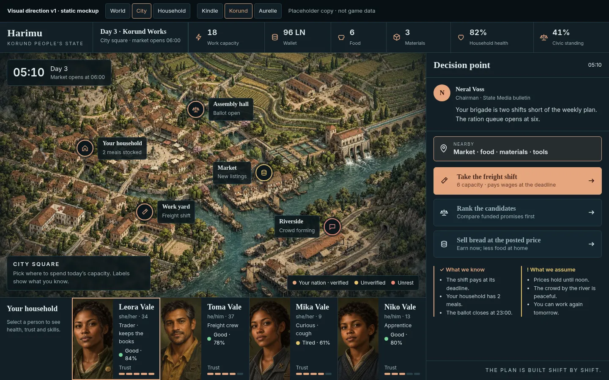
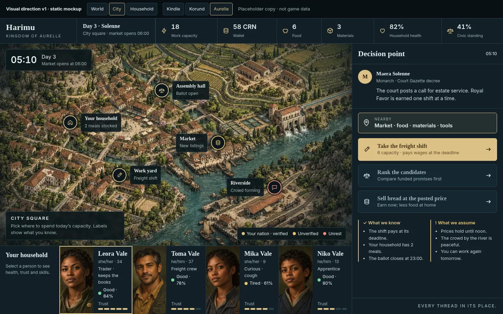
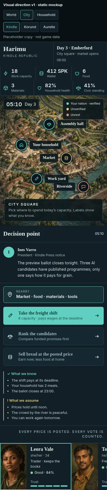
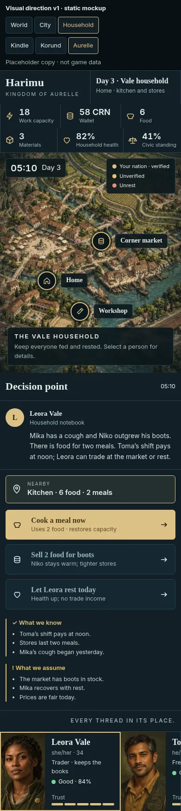

# Visual direction v1 (static mockup) — #180

The reference is for **style only**, adapted to Harimu's World, City and Household screens. The page is a review aid: it isn't wired to game data, all copy is placeholder, and no game code changes.

- **Live mockup:** `/mockups/visual-direction-v1/` (served from `public/`). Query params: `?screen=world|city|household&nation=kindle|korund|aurelle`, or use the toggles at the top.
- **Source:** `public/mockups/visual-direction-v1/index.html` (one file, no dependencies). Art is the existing `harimu-world-atlas.jpg`, `assets/verdant-ward-town.webp` and the Vale household portraits.

## What it shows
| Element | Harimu mapping |
|---|---|
| Top bar | Title + nation, day and place, then icon/value/label chips: Work capacity, Wallet (SPK / LN / CRN by nation), Food, Materials, Household health, Civic standing |
| Map hero | World: atlas with nation, trade corridor, border and grain-market nodes. City: work yard, market, assembly hall, household, riverside. Household: home, corner market, workshop. Legend: verified (nation accent) / unverified / unrest |
| Decision point | Leader or household note, a nearby stop, one primary action plus two secondary choices, and **What we know / What we assume** |
| Cast cards | Household: Leora, Toma, Mika and Niko Vale with status and a 5-step trust bar. World: monogram cards for leaders and notables (no portraits yet) |
| Type | Serif headings (Iowan / Palatino / Georgia), sans body (Inter / system) |
| Nation accent | Kindle teal `#5fd0c0`, Korund copper `#e6a57e`, Aurelle gold `#dcc185`, all on slate `#0c171c` / `#111f26` |

## Accessibility and mobile
- Every accent and the body text clear WCAG AA on the slate panels. The primary action uses dark ink on the accent.
- Map nodes, choices, cards and toggles are real links and buttons with a visible `:focus-visible` ring. Toggles and cards expose `aria-pressed`.
- Landmarks: review `nav`, `header`, `main` (map), `aside` (Decision point), and the cast `section`. Trust bars carry `role="img"` with a text label.
- Under 900px the layout is one column: map, then the Decision panel, then scroll-snap cards. Chips wrap and node labels flip near the right edge. Reduced motion is respected.

## Screenshots
World · Kindle (1440×900)

City · Kindle

Household · Kindle

City · Korund accent

City · Aurelle accent

Mobile 390×844: City · Kindle, Household · Aurelle

 

## Open questions for Patrick
1. Should the accents be per nation (as shown), or teal everywhere with the nation shown only by emblem and paper motif (#85)?
2. Should the Decision point stay a persistent right panel or open on demand?
3. On World, should the cast row show leaders, or your own household again?
4. Do we need leader portraits, or are monograms enough for now?

## Known gaps
- On mobile, some node labels can overlap each other on dense city art.
- The "trust" and "civic standing" numbers are illustrative; no such system exists yet.
