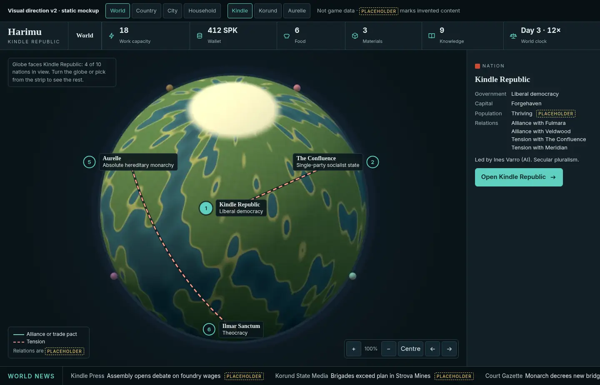
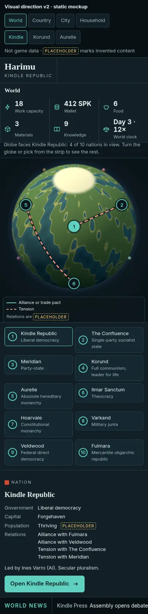
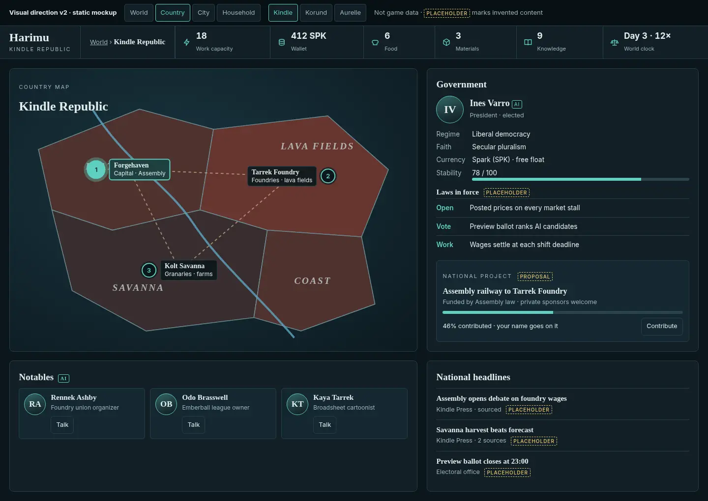
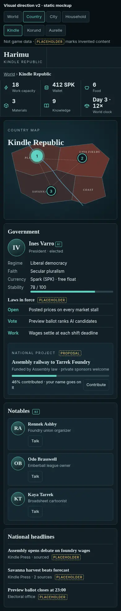
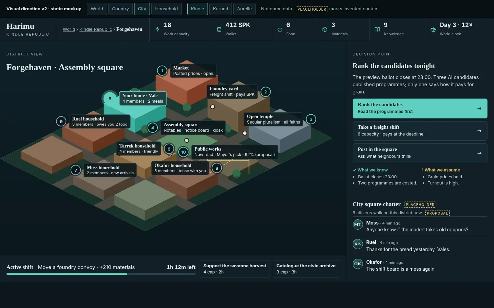
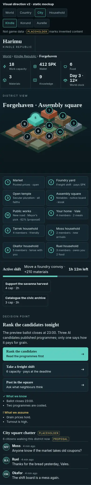
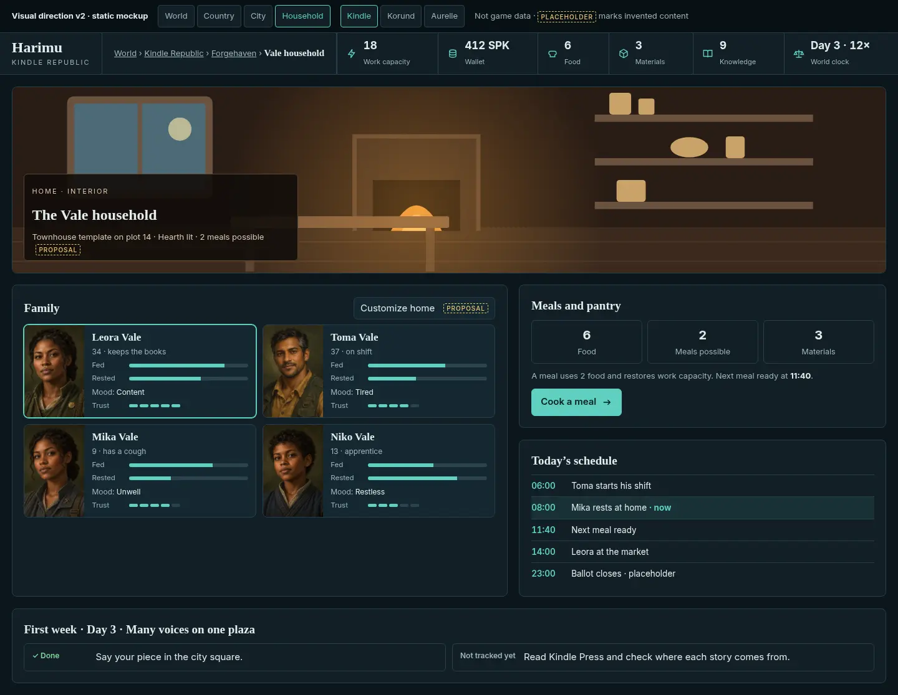
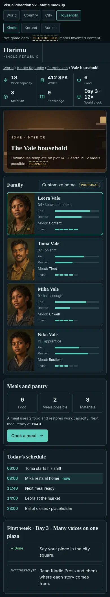

# Visual direction v2 (static mockup) — #180

Patrick's verdict on v1 (#184): **world, country, city and household must each be a visually different scene**, not one template reused. v2 keeps the shared design language and gives each zoom level its own composition and purpose. v1 stays in the repo for comparison (`docs/VISUAL_DIRECTION_V1.md`).

- **Live mockup:** `/mockups/visual-direction-v2/?screen=world|country|city|household&nation=kindle|korund|aurelle`. Toggles are at the top. Extra params: `&pick=<nation>` (World card) and `&peek=0..3` (City neighbour peek).
- **Source:** `public/mockups/visual-direction-v2/index.html` (one file, no dependencies). Art: `harimu-world-atlas.jpg` and the Vale household portraits. The country map, isometric district and home interior are drawn in SVG as placeholder art.
- It's static. It isn't wired to game data. Anything marked **PLACEHOLDER** is invented for layout; anything marked **PROPOSAL** follows the vision proposal below.

## Shared language (every scene)
Dark slate (`#0c171c` / `#111f26`). A nation accent: Kindle teal `#5fd0c0`, Korund copper `#e6a57e`, Aurelle gold `#dcc185`. Serif headings with a sans body. The top bar has breadcrumbs (World › Nation › City › Household) and icon/value/label stat chips: Work capacity, Wallet (SPK / LN / CRN), Food, Materials, Knowledge, World clock.

## Four scenes, four compositions
| Zoom | Composition | Purpose |
|---|---|---|
| **World** | Full-bleed atlas of all 10 nations (positions from the repo's nation table), with relation lines: solid = alliance or trade pact, dashed = tension. A global news ticker runs underneath, and a nation card docks on the right when you pick one (government, capital, population band from #81, relations, "Open <nation>"). **No portrait row.** | Compare nations and read the world. |
| **Country** (new) | The nation's own map (regions, river, roads) with its three real cities from `lib/cities.ts`, capital highlighted. The **Government** panel shows the AI ruler (Ines Varro, Neral Voss, Maera Solenne), regime, faith, currency, a stability meter, laws in force, and a **national project** with contribution progress. Below: the nation's real **Notables** (`lib/notable-roster.ts`), each with a Talk action, and **national headlines** from Kindle Press, Korund State Media or the Court Gazette. | Understand who rules, what's built and what's said. |
| **City** | An isometric **district** with numbered places: market, workplace (Foundry yard / Brigade yard / Royal estate), square (Notables, notice board, kiosk), temple (Open temple / Workers' hall, since Korund has state atheism / Kinward hearth-temple), and a **public works** site under scaffolding. **Neighbouring households** (Tarrek, Moss, Okafor, Ruel; placeholder names) are labelled with members plus mood or relationship, and are selectable to **peek in**. **Your home is highlighted** in the nation accent with a halo and links to Household. A shift strip shows the active shift and open work orders. A right rail holds the **decision card** (primary plus secondary choices, What we know / What we assume) and city square chatter, with a "citizens walking this district" count. | Choose where to go today and see who lives around you. |
| **Household** | A warm **interior** scene (hearth, table, pantry shelves, window). **Family** portrait cards for the Vale household show needs (fed, rested), mood and a 5-step trust bar. There's a **Meals and pantry** panel with Cook a meal, **Today's schedule** as a timeline with a "now" marker, and **first-week goals** using the real day-3 arc from `lib/first-week.ts`, with the same Done / To do / Not tracked yet states as #162. "Customize home" refers to the plot plus template idea. | Look after the family and plan the day. |

## Alignment with Content's vision proposal (not yet adopted)
[thachp/harimu-docs#6](https://github.com/thachp/harimu-docs/pull/6) "[PROPOSAL] Why play Harimu" is **still a proposal**. Where it fits, the scenes line up with it:
- **Household building** (§2.1): homes sit on plots and use a template (townhouse), with "Customize home".
- **City building** (§2.2): a public works site, visible in the district, funded by contributions. Per-nation sponsor: the Mayor's pick (Kindle), plan quota (Korund), chartered guild hall (Aurelle).
- **Nation building** (§2.3–2.4): a national project with contribution progress and "your name goes on it". Who picks it follows the §2.4 table: Assembly law (Kindle), Five-Year Plan quota (Korund), royal decree with fiefs owing contributions (Aurelle).
- **Walkable cities** (§5): the City scene is the district from the "suggested first step" (market street plus square), showing online citizens, a notice board and kiosk, and construction you can see.

## Accessibility and mobile
- **Contrast** (WCAG, measured): muted text on panels is 7.2–7.9:1, accents on panels 8.1–9.6:1, ink on accent buttons 8.4–9.6:1, placeholder amber 10:1, interior caption 11.9:1.
- **Focus:** every pin, list item, card, toggle and button is a real `<button>` or `<a>` with a 3px `:focus-visible` ring. Selection uses `aria-pressed`, and the nation card and peek panel are `aria-live`. Meters and trust bars carry `role="img"` with a text label. The breadcrumb marks `aria-current="page"`.
- **Mobile (<900px):** single column. **Map labels never overlap.** Scenes show numbered pins only, and the full labelled list sits under the scene as large tap targets. That fixes v1's overlapping city labels. The automated check counts 0 marker overlaps in every screenshot. Reduced motion is respected (nothing animates).

## Screenshots (1440×900 and 390×844)
Full-size PNGs are on the box at `/workspace/vd/v2/`; compressed copies are here.

| Kindle 1440 | Kindle 390 |
|---|---|
|  |  |
|  |  |
|  |  |
|  |  |

Korund accent: [World](visual-direction-v2/world-korund-1440.webp) · [Country](visual-direction-v2/country-korund-1440.webp) · [City](visual-direction-v2/city-korund-1440.webp) · [Household](visual-direction-v2/household-korund-1440.webp). Aurelle: [City](visual-direction-v2/city-aurelle-1440.webp) · [Household 390](visual-direction-v2/household-aurelle-390.webp). Neighbour peek: [City, Tarrek household](visual-direction-v2/city-kindle-1440-peek.webp).

## Open questions for Patrick
1. Should the World nation card dock on the right (as shown) or float next to the picked nation?
2. Should the Country scene be its own nav tab, or reached only by zooming from World?
3. Should the City district be drawn isometric (as shown) or walkable Three.js first (per the proposal's §5)?
4. How much of a neighbour's home should "peek in" reveal (members, mood, relationship), and what needs their consent?
